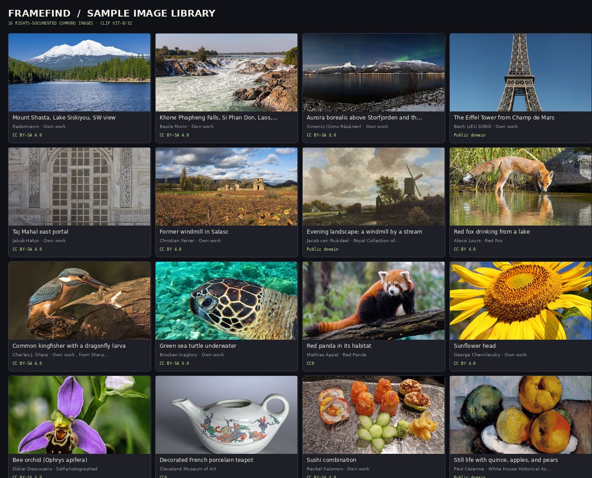
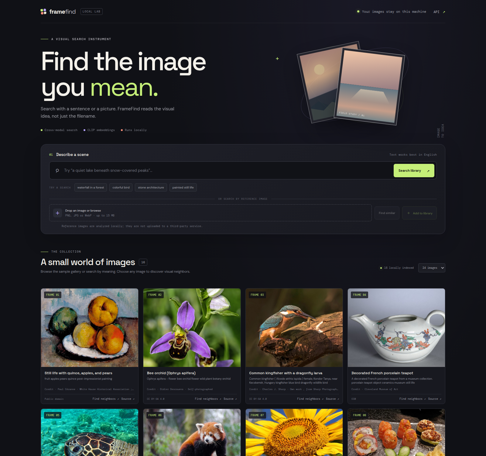

# FrameFind — AI Image Search Engine

A local-first visual-search system that finds images by meaning, not filename. Describe a scene in plain English, provide a reference image, or ask for visual neighbors. FrameFind embeds text and images into a shared CLIP space, stores normalized vectors and provenance in SQLite, then ranks candidates by exact cosine similarity.





This is a constrained research/demo system, not a hosted search product. It does not train a model, upload user images to an AI provider, or publish the Commons gallery as a separate dataset.

## What is built

- **Image ingestion:** rights-checked sample ingestion from an explicit Wikimedia Commons manifest, plus local PNG/JPEG/WebP upload and indexing.
- **Embedding generation:** frozen `openai/clip-vit-base-patch32` image and English text encoders; vectors are L2-normalized float32 embeddings (512 dimensions).
- **Vector storage:** SQLite holds image metadata, source/creator/license fields, checksums, and vector blobs.
- **Search:** text-to-image, image-to-image, and “find neighbors” use exact dot-product ranking over normalized vectors (cosine similarity).
- **Interface:** a responsive, accessible local web app with visual gallery cards, provenance links, text prompt chips, upload search, and add-to-library action.
- **API:** FastAPI health, collection, search, ingestion, and similarity endpoints with interactive OpenAPI docs at `/docs`.
- **Tests:** deterministic vector-store, license-filter, API, upload, and error-path tests; no internet/model download is needed for the unit suite.

## Run it locally

Python 3.10+ and `uv` are recommended. The first seed run contacts Wikimedia Commons, downloads the 16 curated thumbnails after a current license check, then downloads/caches the public CLIP checkpoint. First-run time and storage depend on network speed.

```bash
uv sync --extra test
uv run image-search seed-demo
uv run image-search serve
```

Open <http://127.0.0.1:8000>. Keep the service bound to localhost unless you add authentication, access control, upload quotas, rate limits, and deployment-specific privacy/security review. Uploaded images are stored in ignored `data/uploads/`; embeddings and SQLite index are also local generated state.

Useful commands:

```bash
uv run image-search stats
uv run image-search evaluate
uv run pytest
uv run ruff check src tests
uv run ruff format --check src tests
uv build
```

To remove locally cached material, stop the service and delete `data/index.sqlite3*`, `data/uploads/`, and `data/demo/images/` / `data/demo/assets.json`. Running `seed-demo` again rechecks current Commons licensing metadata before fetching sample images.

## Search and storage design

`src/image_search/embedder.py` lazily loads the checkpoint and performs inference in batches. The image and text outputs are separately normalized to unit length. `src/image_search/store.py` stores vector bytes and metadata in SQLite, reloads the small matrix on each query, and computes `matrix @ query` with NumPy. It is deterministic and exact for the current contents; it has no approximate-neighbor index or text keyword fallback.

The default hard cap is **25,000 images**, because this exact-scan design is O(ND) per query (N indexed images, D=512) and is intentionally for small local collections. Raising the cap does not make the implementation scalable: larger deployments need an ANN/vector backend, measured recall/latency, resource limits, authentication, and privacy controls. The 25k cap is a guardrail, not a benchmarked capacity claim.

## Evaluation

`reports/evaluation_queries.json` defines 16 manually authored, paraphrased prompt-to-target checks against the same 16-image demo gallery. `uv run image-search evaluate` reports Hit@1, Hit@5, MRR, and each target rank in `reports/evaluation_summary.json`.

On that exact curated set, CLIP achieved **Hit@1 15/16 (93.75%)**, **Hit@5 16/16 (100%)**, **MRR 0.9688**, and mean target rank **1.06**. The one top-1 miss was “a stone windmill in a French village”: the historical windmill painting ranked first, while the intended village windmill photo ranked second. These are descriptive results on one deliberately small gallery, not a quality estimate for a broader collection.

**This is a tiny, gallery-specific smoke benchmark, not an independent test set.** Targets and prompts were curated for this demo; the gallery is not representative; a result cannot establish general image-search quality. Cosine scores are relative similarity values, not probabilities. Text use is English-only, and no Amharic, cross-cultural, fine-grained, or independent-query quality claim is made. The benchmark is intentionally small and single-gallery; it is not compared against alternate encoders or baselines.

## Model and limitations

The frozen CLIP model is used only as an off-the-shelf encoder; no fine-tuning or project-specific model training occurs. Its model card documents research intent, warns against untested deployment, states that non-English use is not evaluated, and notes known weaknesses such as fine-grained recognition and counting, as well as bias concerns. This project keeps the experiment local and does not present it as an unconstrained production service. Read the [Hugging Face model card](https://huggingface.co/openai/clip-vit-base-patch32) and [upstream OpenAI CLIP repository](https://github.com/openai/CLIP) before reuse.

Other limits: exact vector search is linear; uploaded images are not virus-scanned and no user authentication or quotas exist; local sample rights metadata comes from Commons and should be checked at the linked file page; sample thumbnails may be withdrawn or relabeled upstream; no independent licensing audit or face/personality-rights audit is claimed; the project has no public deployment and no production availability/SLA.

## Data and licenses

The curated sample manifest is `data/demo/catalog.json`; the seed command reads current Wikimedia Commons machine-readable metadata and refuses a file unless its license label is Public domain, CC0, CC BY 2.0–4.0, or CC BY-SA 2.0–4.0 and no reuse restriction/deletion notice is present. Each resulting demo card links to its Commons file page and retains the creator credit, license name/link, file/thumbnail checksums, and curated tags in `data/demo/assets.json`. See [DATA_SOURCES.md](DATA_SOURCES.md) for the detailed attribution and reuse notes. Commons metadata is community-maintained; verify local legal conditions before redistribution. ShareAlike terms still apply to adaptations.

User uploads are not checked for copyright or other reuse rights. They remain local, are marked “rights not verified,” and must not be redistributed without permission. This repository's MIT license applies to the original source code only, not to the separately licensed sample images or upstream model artifacts.

## Project status

Built locally, with the curated demo gallery and evaluation artifacts created only after real CLIP inference succeeds. No GitHub remote, Hugging Face artifact, or public Space is configured for this project. Portfolio publishing remains pending access under the approved `bereket-web` owner; this project is not published under `bereket74`. No project-scoped Hugging Face token has been used.

## Repository map

```text
src/image_search/       FastAPI API, CLIP encoder, SQLite vector index, Commons seeder, evaluation, CLI
src/image_search/static/ Responsive browser UI, CSS, and JavaScript
data/demo/catalog.json  Curated Commons file titles and search tags
reports/                Prompt evaluation specification and generated metrics
 docs/                  Architecture notes and Mermaid diagram
tests/                  Offline unit and API tests
```
