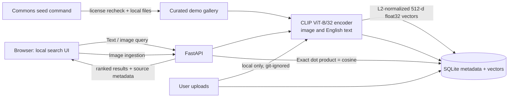

# FrameFind architecture

Search, upload, image content, and index data flow between the browser and the local FastAPI process. The page references Google Fonts, so a browser with network access may make a separate font request; no prompt or image content is sent to Google. For strict offline use, self-host or replace those font links. The seed command reads a fixed Commons manifest, rechecks each file's current `LicenseShortName`, `Restrictions`, and deletion metadata through the official API, downloads the thumbnail, computes an embedding, and persists both vector and provenance fields. User uploads are placed under `data/uploads/`, excluded from version control, and are not sent to third-party services.

The search index is an intentionally transparent SQLite store plus a NumPy exact cosine scan. Cost is O(ND) per request for N images and D=512 dimensions. This design is suited to a small local gallery; it is not an ANN/vector-database scale-out architecture. A configurable hard limit defaults to 25,000 records. Larger libraries need a measured ANN backend and recall/latency tests before the limit is raised.
